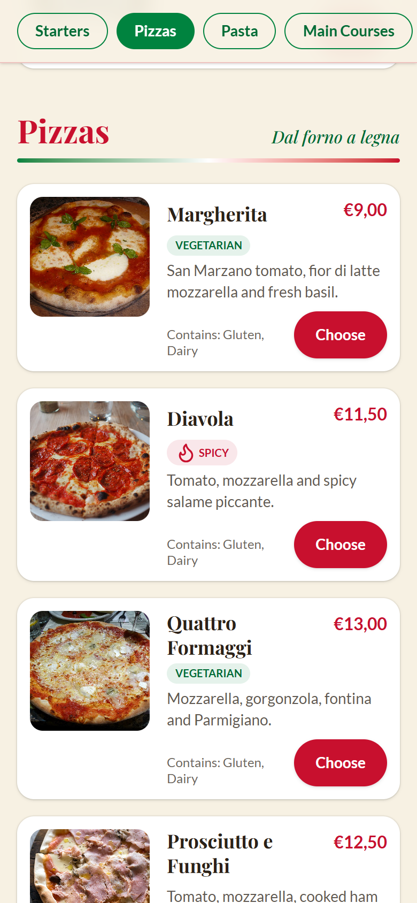
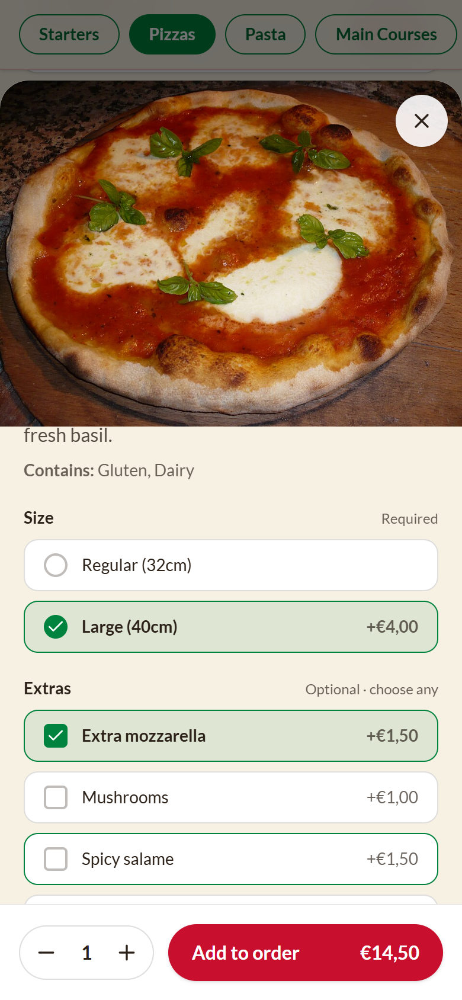
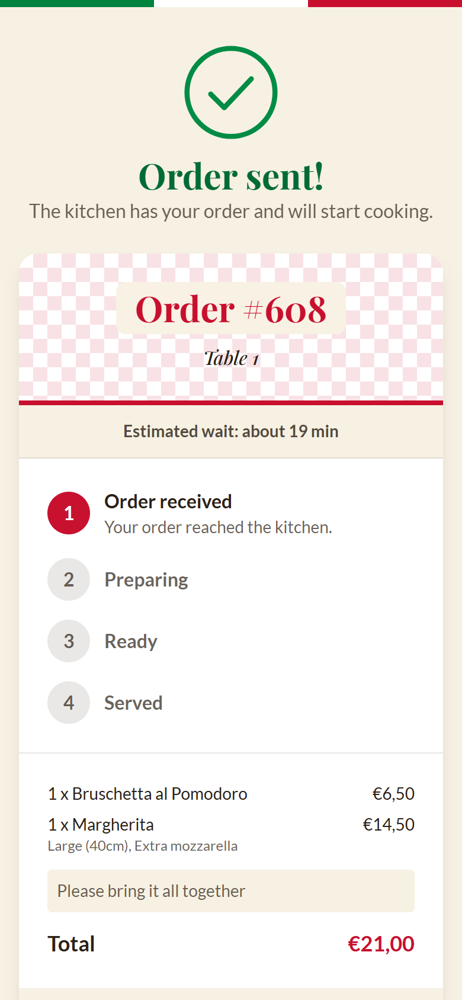
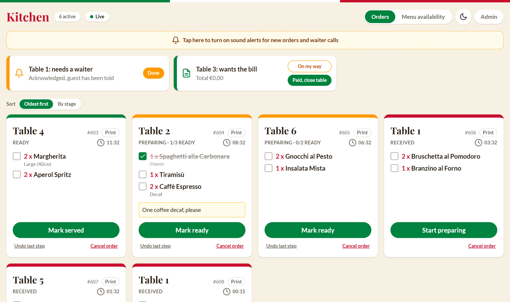
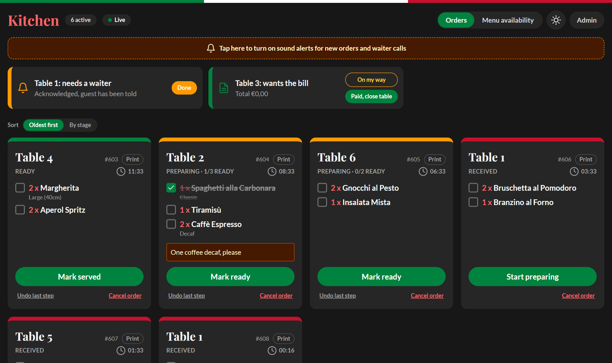
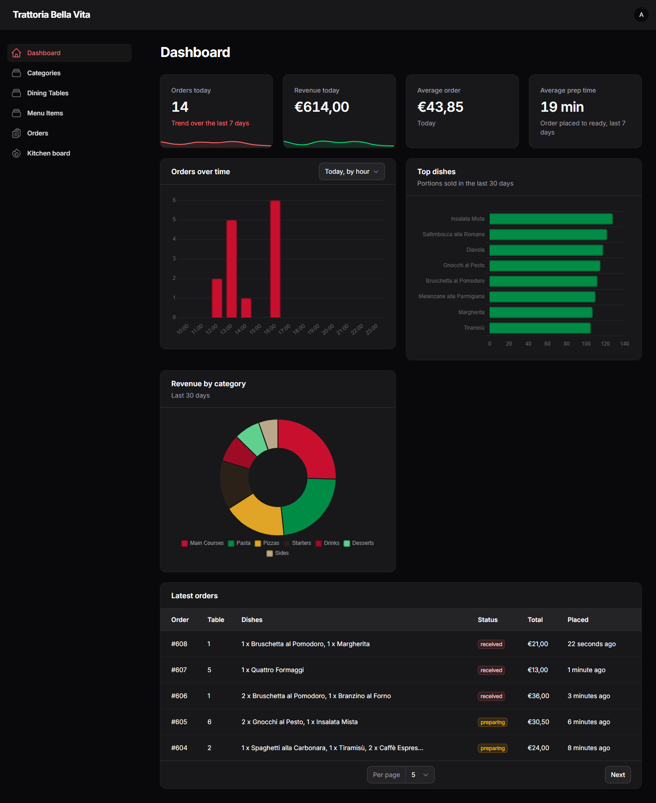
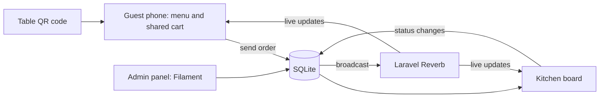

# Trattoria Bella Vita: QR table ordering

A QR-code ordering system for an Italian restaurant. Guests scan the code on their table, browse the full menu (every dish with a photo, price and description), and send their order straight to the kitchen. No waiter needed to take the order.

Built with **Laravel 13, Livewire 4, Filament 5, Tailwind CSS 4, Laravel Reverb** and SQLite.

| Menu | Dish options | Order sent |
|---|---|---|
|  |  |  |

| Kitchen board | Kitchen, dark mode |
|---|---|
|  |  |



## What it does

**For guests (phone, no app or login)**
- Scan the table's QR code and see the whole menu, grouped by category, in English, Italian or Portuguese.
- Search, filter (vegetarian, spicy, gluten-free, dairy-free) and jump between categories; the active category follows the scroll.
- Open a dish for a large photo, allergens and options (size, extras), with the price updating live.
- Tapping Add responds instantly; the server catches up in the background.
- Share one cart with everyone at the table: a second phone sees additions within a moment.
- Follow the order live: received, preparing, ready, served, with an estimated wait based on how long recent orders really took and per-dish progress ("2 of 3 dishes ready").
- Call a waiter (and see when one is on the way), see the table's combined bill and ask for it.
- Sections can have opening hours, for example a dinner-only pizza menu: it stays visible but cannot be ordered outside its hours.

**For the kitchen (tablet or monitor)**
- New orders appear instantly with a chime. One card per order, with a running timer that turns red when an order is late.
- One tap moves an order through its stages. Tick dishes off as they come up. Notes and chosen options are on the card.
- Made a mistake? "Undo last step", "Bring back" for a served order, or "Cancel order" (cancelled orders drop off the bill and the sales figures).
- Sort by age or by stage, print a narrow ticket for any order, and switch dishes off when the kitchen runs out. Open customer menus update immediately.
- Waiter and bill requests show at the top ("On my way" tells the guest, "Paid, close table" ends the session).
- A live connection indicator, dark mode for dim kitchens, and sound that is enabled with one tap (browsers require it).

**For the manager (admin panel)**
- Dashboard: orders and revenue today, average order, average prep time, orders per hour, top dishes, revenue by category and the latest orders.
- Orders: searchable, filterable history of every order with a full timeline.
- Dishes and categories: price in euros, photo upload, allergens, options, opening hours, Italian and Portuguese translations, and drag-to-reorder.
- Tables, with a printable QR code for each one.

## How it works



- Each table has an unguessable URL (`/t/{token}`). Scanning it opens a **table session** that everyone at that table shares: cart, orders and bill. Staff close the session when the table pays, and the next scan starts a fresh one.
- Livewire components hold the UI state on the server. When something changes, an event is broadcast through Reverb and every open screen for that table (and the kitchen) updates. Order totals and option prices are always recomputed on the server; the browser never sends a price.
- **Fast taps:** the menu page does not re-render when the cart changes. The browser shows the new quantity immediately, batches quick taps into one request, and the server confirms with a few bytes. The dish popup and cart drawer are separate components, so opening them never re-renders the 140 KB menu. Each page ignores the broadcasts it caused itself (events carry a page id).
- If the Reverb server is not running the app keeps working: broadcasts fail silently and screens fall back to slow polling.
- Dish photos are served from `public/images/menu`. Uploads from the admin panel go to the same folder, so no `storage:link` step is needed.

## Run it locally

Requirements: PHP 8.3+, Composer, Node 22+.

```bash
composer install
cp .env.example .env
php artisan key:generate
touch database/database.sqlite   # on Windows: type nul > database\database.sqlite
php artisan migrate --seed       # menu, 8 tables and the admin user
npm install
npm run build
```

Then start everything with one command:

```bash
npm run serve                    # site on http://127.0.0.1:8000 and live updates (Reverb) on port 8080
npm run serve -- --lan           # also reachable from phones on your network
npm run serve -- --vite          # additionally runs Vite while you edit CSS or JS
```

| What | Where | Login |
|---|---|---|
| Customer menu | `http://127.0.0.1:8000` (opens table 1) | none |
| Kitchen board | `/kitchen` | `admin@trattoria.test` / `password` |
| Admin panel, QR codes | `/admin` | same |

Set `APP_TIMEZONE` in `.env` to your restaurant's timezone (default `Europe/Lisbon`); it decides what "today" means on the dashboard and when menu sections open.

### Try it on a real phone
1. Find your computer's network address (for example `192.168.1.20`).
2. Set `APP_URL=http://192.168.1.20:8000` in `.env` and run `npm run serve -- --lan`. Allow Node and PHP through the firewall if asked.
3. Open `/admin`, go to Dining Tables and press "Print all QR codes", or open `/qr/1` on screen and scan it.

### Demo mode
```bash
php artisan demo:history 14          # 14 days of past orders, so the dashboard has data
php artisan demo:live --auto-kitchen # simulated guests ordering and a simulated chef (Ctrl+C to stop)
```
Open `/kitchen` in one window and watch it move on its own. `demo:live` runs until you stop it, so stop it with Ctrl+C in the same terminal; on Windows, closing the terminal tab is the safest way to be sure it ends.

## Tests

```bash
php artisan test        # 70 PHP tests: ordering rules, options, shared cart, sessions, kitchen, schedules, admin, translations
./vendor/bin/pint --test
npm run e2e             # real browser: ordering, live updates over websockets, accessibility, small phones
```

`npm run e2e` needs the site running (`npm run serve`), a freshly seeded database (`php artisan migrate:fresh --seed`) and Chrome or Edge (set `CHROME_PATH` if it is not found). It drives several simulated devices at once and runs the axe accessibility engine on every guest screen and on the kitchen board.

GitHub Actions runs code style, the PHP tests, the build and the browser tests on every push (`.github/workflows/tests.yml`).

## Project layout

| Path | Purpose |
|---|---|
| `app/Livewire/` | Menu, dish popup, cart drawer, order tracking, bill and the kitchen board |
| `app/Support/Ordering.php` | Business rules: shared cart, placing orders, service requests |
| `app/Support/Realtime.php` | Safe broadcasting (never breaks a request if Reverb is down) |
| `app/Models/` | Eloquent models; `MenuItem` validates option selections and computes prices, `Order` knows its stages |
| `app/Filament/` | Admin resources and dashboard widgets |
| `app/Console/Commands/` | `demo:history`, `demo:live` and `tables:tokens` |
| `lang/` | Italian and Portuguese UI strings (dish text lives in the database) |
| `scripts/serve.mjs` | The one-command start |
| `tests/` | PHP tests, plus `tests/e2e/` for the browser suite |

## Design notes
- No emojis anywhere: icons are inline SVG so they render the same on every device.
- Colours are the Italian flag: tomato red `#c8102e`, basil green `#00833f` (a touch deeper than the flag's own green so white text passes WCAG AA), cream `#f7f1e3`. Headings use Playfair Display.
- Accessibility is checked automatically: zero axe violations on the menu, popup, cart, order page, bill and kitchen. Main buttons are 44 px tall, the language switch and filter chips at least 40 px, inputs are 16 px so iPhones do not zoom, and the popup and cart trap keyboard focus and close with Escape. It was also checked in emulated iPhone, Pixel and Galaxy profiles, including landscape. Motion respects `prefers-reduced-motion`.
- Money is stored as integer cents. Orders copy the dish name and price at the time of ordering, so later menu edits never change past orders.
- SQLite waits up to 5 seconds for a lock, so simultaneous taps from several phones do not fail. (WAL mode was tried and dropped: on Windows it corrupted the file when the dev server and artisan commands touched it together.)

## Photo credits
Dish photos come from Wikimedia Commons under Creative Commons licences. Every photo, its author and licence is listed in the app at `/credits` (data in `resources/photo-credits.json`).

## Ideas for next steps
Online payment, a PWA for the kitchen tablet, per-dish preparation stations, rotating QR tokens to stop remote ordering, and your own photography for the dishes.

## Shared hosting and the portfolio demo

The live demo (https://trattoria.franciscowebdev.com) runs on shared hosting, which cannot keep Reverb running. These settings in its `.env` change the behaviour; with none of them set the app works exactly as above.

| Setting | Demo value | Effect |
|---|---|---|
| `REALTIME` | `polling` | Screens refresh by polling instead of listening to websockets. Build the JS with `VITE_REALTIME=polling npm run build` so no websocket connection is attempted. |
| `POLL_KITCHEN`, `POLL_GUEST`, `POLL_BILL` | `5`, `10`, `15` | Polling interval in seconds (defaults 20, 20, 30). |
| `BROADCAST_CONNECTION` | `null` | No broadcasting attempts. |
| `QUEUE_CONNECTION` | `sync` | No queue worker needed. |
| `DEMO_MODE` | `true` | Shows a "Portfolio demo" strip, adds `/demo/kitchen` (one-click staff view that cannot open the admin panel) and removes orders older than `DEMO_KEEP_HOURS` (default 6), at most once an hour. |

Deploying: the server runs PHP 8.3, so `composer.json` pins `config.platform.php` to 8.3.36 (keep it when updating packages). The app lives outside the web folder (`~/trattoria-app`) and only the contents of `public/` sit in the subdomain folder, with `index.php` pointing at the app and calling `$app->usePublicPath(__DIR__)`. Seed a fresh database with `php artisan migrate --seed --force`, then change the admin email and password.
